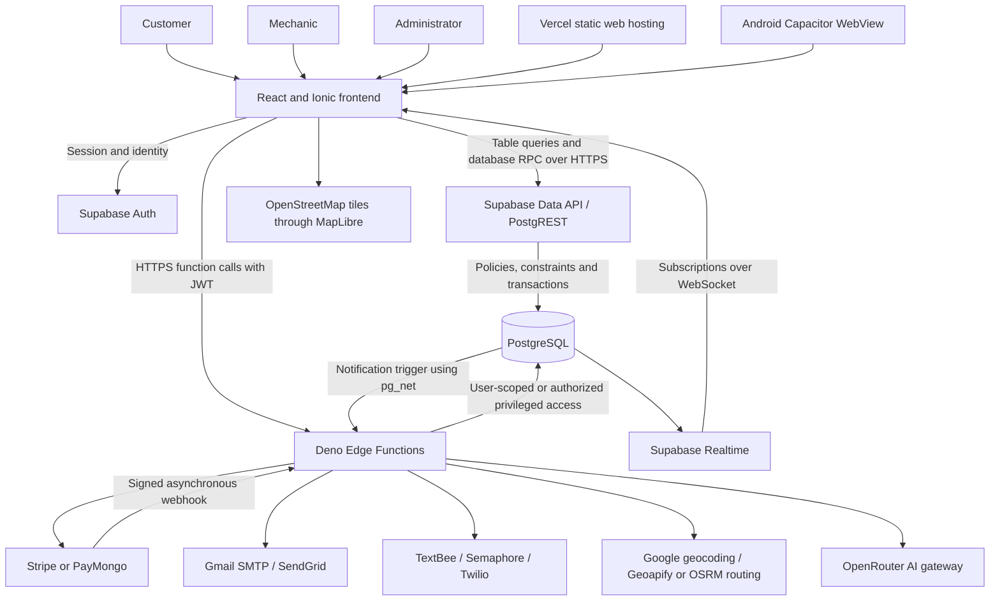
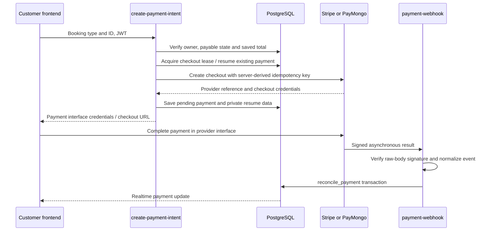

# LS Customs — System Integration Architecture and Code Review

Prepared for a System Integration Architecture presentation. Review date: October 12, 2026.

## 1. Presentation opening

**LS Customs is a car rental and mobile mechanic platform that connects customers, mechanics, and administrators through a shared Supabase backend. A React application provides the screens, PostgreSQL enforces business rules, Edge Functions integrate external services, and realtime subscriptions keep users informed of changes. The same frontend is packaged for Android using Capacitor.**

This review describes the source code currently in this repository. It is a static architecture and implementation review, not proof that the deployed database, payment accounts, notification services, or Android app have passed live acceptance testing. Dependency versions below are declared ranges, not verified installed versions. Older documentation sometimes describes plans or placeholders that no longer match the implementation.

## 2. What each user can do

| User | Features | Main implementation files |
|---|---|---|
| Guest | Browse the public workspace, help, FAQs, legal information; begin authentication | `apps/web/src/components/views/GuestWorkspace.tsx`, `apps/web/src/pages/public/`, `apps/web/src/components/auth/AuthModal.tsx` |
| Customer | Email/SMS OTP and Google sign-in, account setup, profile and saved addresses | `components/auth/AuthModal.tsx`, `components/AccountSetup.tsx`, `components/views/Profile.tsx`, `hooks/useAuth.ts` under `apps/web/src/` |
| Customer | Browse rental vehicles, check dates, reserve, pay and view bookings | `components/views/Rentals.tsx`, `RentalPayment.tsx`, `hooks/useVehicleAvailability.ts`, `hooks/useCustomerBookings.ts` |
| Customer | Select a mechanic service, choose a location and schedule, review pricing, pay and track status | `components/views/mechanic/MechanicBookingFlow.tsx`, its `Step*.tsx` components, `hooks/useBookingTracking.ts` |
| Customer | Request emergency assistance; emergency dispatch follows a pay-on-arrival exception | `components/common/EmergencyMechanicModal.tsx`, database function `assign_booking_mechanic` |
| Mechanic | See assigned jobs, advance job status and share GPS while travelling | `components/views/MechanicDispatch.tsx`, `hooks/useMechanicGps.ts` |
| Customer and admin | Support tickets, threaded replies and realtime ticket updates | `components/chat/TicketForm.tsx`, `components/common/TicketThread.tsx`, `TicketRealtimeProvider.tsx`, backend `create-ticket/index.ts` |
| Customer | AI support chat and authenticated booking context | `components/chat/ChatBot.tsx`, backend `chatbot/index.ts` |
| Admin | Overview, fleet, services, mechanics, users, bookings, tickets, revenue, audit logs and account security | `components/admin/AdminLayout.tsx` and its imported panels; `hooks/useAdmin*.ts` |

Frontend paths shortened in this table are relative to `apps/web/src/`; backend function paths are relative to `apps/backend/supabase/functions/`. The code evidence section provides clickable full locations and line numbers.

## 3. Architecture

### Architecture classification

The most accurate description is **a layered, database-centered application using Backend as a Service and serverless integration functions**.

- Presentation layer: React components and Ionic application shell.
- Client orchestration layer: React hooks, local state, session management and Supabase SDK calls.
- Application and integration layer: authenticated Deno Edge Functions and provider adapters.
- Business and persistence layer: PostgreSQL tables, transactions, RPC functions, triggers, constraints and Row Level Security (RLS).
- External services: payment gateways, email/SMS delivery, mapping/routing and an AI model gateway.

This repository is a monorepo: the frontend, backend and shared packages live together. Its separately deployed Edge Functions do not by themselves make it a full microservices architecture: they share the same database and business domain. There is no Express server in the inspected application structure.

### Component diagram



Arrows describe implemented communication paths, not confirmation that every provider is enabled in production. A browser request can go directly to Supabase; Vercel is configured to build and serve the frontend rather than host the Supabase database.

### Repository responsibilities

| Location | Responsibility |
|---|---|
| `apps/web/src/main.tsx` | Starts React inside `IonApp`, installs toast provider and Suspense loading fallback |
| `apps/web/src/App.tsx` | Chooses customer/admin/public screens, manages global UI state, deep links and error boundary |
| `apps/web/src/components/` | Customer, mechanic and administrator user interfaces |
| `apps/web/src/hooks/` | Reusable data access, authentication, payments, tracking and subscriptions |
| `apps/web/src/supabaseClient.ts` | Creates the shared Supabase client and selects browser/native session storage |
| `apps/backend/supabase/functions/` | External integration endpoints and request authorization |
| `apps/backend/supabase/functions/_shared/` | Payment adapter, CORS, Supabase clients, routing, virtual journey and email helpers |
| `apps/backend/supabase/migrations/` | Versioned schema and changes to server-side business rules |
| `apps/backend/supabase/seed.sql` | Development seed data |
| `packages/shared-types/src/` | Database and domain TypeScript definitions |
| `packages/config/` | Shared TypeScript configuration |
| `vercel.json` | Frontend build/output settings, SPA rewrites and HTTP headers |
| `apps/web/capacitor.config.ts`, `apps/web/android/` | Android packaging of the built frontend |

## 4. Technology stack

| Technology | Declared version or evidence | Purpose |
|---|---|---|
| TypeScript | `^5.6.0` in frontend/backend package manifests | Typed application and integration code |
| React / React DOM | `^18.3.1` | UI components and rendering |
| Ionic React | `^8.5.0` | Application shell and mobile-oriented UI infrastructure; much of the interface also uses custom React/CSS |
| Vite | `^6.0.5` | Development server and production frontend bundling |
| Capacitor | Core/Android `^8.5.2`, with separately versioned plugins | Android WebView packaging, device geolocation, preferences and deep links |
| Supabase JavaScript SDK | `^2.49.0` | Auth, database queries/RPC, functions and realtime access |
| Supabase / PostgreSQL | CLI declared `^2.115.0`; server version not established here | Managed authentication, relational storage, Data API and realtime |
| Deno | Backend scripts look for Deno; script diagnostic requests Deno 2 | Edge Function runtime and backend checks |
| MapLibre GL | `^6.13.0` | Interactive map rendering using OpenStreetMap raster tiles |
| Stripe SDKs | React `^6.10.0`, JS `^9.16.0` | Stripe payment interface; backend also supports PayMongo hosted checkout |
| npm workspaces / Turborepo | npm `10.8.2`, root Turbo `^2.1.0` | Monorepo dependency management and task coordination |
| Docker / Supabase CLI | Local scripts call `supabase start` | Local database, auth and function development stack |
| Vercel | Root and frontend `vercel.json` | Static frontend deployment and SPA routing |
| PGlite, Node test runner and Deno tests | Backend dev dependency and scripts | Automated database/security and Edge Function checks |

`react-router-dom` is a declared dependency, but `App.tsx` primarily uses React view state and the browser History API. Avoid saying all routing is implemented through React Router.

## 5. How the whole system works

### A. Authentication and authorization

1. A customer chooses email OTP, phone OTP or Google OAuth.
2. Email OTP uses Supabase Auth directly. Phone login uses the custom phone-OTP flow where necessary, or verifies a Supabase SMS OTP.
3. A successful login establishes an access token and refresh token. The SDK persists the session in browser local storage or Capacitor Preferences on a native device.
4. `useAuth` loads identity/profile information. `App.tsx` shows the corresponding workspace; account setup collects missing phone information.
5. Admin password login is handled in `useAdminAuth.ts`; role checks also control admin presentation.
6. Real access control belongs on the server: database RLS checks `auth.uid()` and profile roles; privileged functions independently verify identity and ownership before using a service client.

**Presentation point:** Hiding an admin page improves the interface, while database policies and server authorization protect the records.

### B. Car rental flow

1. `useCustomerVehicles` reads active vehicles from PostgreSQL.
2. `useVehicleAvailability` calls `unavailable_vehicles` for the selected interval.
3. `Rentals.tsx` calls `create_vehicle_booking` with a vehicle, dates, optional promo and request ID.
4. The database authenticates the caller, serializes duplicate requests, locks the vehicle, validates rental length and derives the total from the stored daily rate.
5. The booking starts as `pending` with a 30-minute hold. The later migration uses half-open date ranges, `[start, end)`, and an exclusion constraint to protect against overlapping reservations.
6. Payment checkout is prepared by `create-payment-intent`. The amount comes from the saved booking, not a customer-supplied total.
7. The payment provider sends a signed webhook. `reconcile_payment` updates payment state and confirms a pending vehicle booking in one database transaction.
8. Customers see the current booking/payment through data reads and realtime status updates. Admins manage later operational stages.

### C. Scheduled mechanic service flow

1. The customer moves through category, service, location, schedule and review steps.
2. A location is either an owned saved address or a confirmed map pin. The database checks coordinates and the location choice.
3. `create_service_booking` stores the booking and selected service item in one transaction. It calculates service price, travel fee and discount on the server.
4. `StepPayment` creates checkout and observes payment status; successful payment advances the customer to the confirmation screen.
5. **Payment and assignment are separate events.** `reconcile_payment` does not assign a mechanic to a scheduled service. The confirmation screen explicitly says a mechanic will be assigned shortly. Admin booking management provides manual assignment; the separate `assign-mechanic` endpoint can perform authorized automatic selection, but the inspected scheduled customer flow does not invoke it after payment.
6. Automatic selection, when invoked, locks the booking and available candidate mechanics, sorts by distance and rejects schedule conflicts with a travel buffer. Ordinary services require successful payment before automatic dispatch.
7. The assigned mechanic advances `assigned → en_route → in_progress → completed`. Database triggers constrain mechanic transitions and protect booking fields.
8. Status changes produce notification records; realtime subscriptions refresh customer screens and optional delivery integrations send messages.

### D. Emergency service flow

The emergency modal creates a service booking with an emergency type and calls `assign-mechanic`. The database recognizes supported emergency types and sets a server-defined price. Emergency assignment skips the ordinary prepayment requirement because this path is pay-on-arrival. It still requires authentication, booking ownership and mechanic capacity.

### E. Payment integration



A redirect back to the application is not the authoritative payment confirmation. The signed provider webhook updates server state. Provider-specific request and event formats are normalized by `_shared/paymentProvider.ts`. Checkout leases, existing-payment recovery and provider idempotency reduce duplicate checkout creation. Refund handling is implemented in `refund-payment/index.ts` using the shared payment adapter.

### F. Maps, GPS and virtual journeys

These are distinct capabilities:

- Map display: MapLibre renders OpenStreetMap tiles. Map pins provide booking coordinates.
- Geocoding: `geocode-address` calls Google's API on the server so the provider key is kept out of the frontend bundle.
- Mechanic GPS: `useMechanicGps` publishes through `publish_booking_location`. SQL checks assignment, travelling status, accuracy, freshness, update rate and implausible jumps. Only a current fix is retained per booking.
- Customer live location: separate tracking hooks update the customer destination for an active booking.
- Route estimate: `booking-route` uses Geoapify when its key is configured, otherwise a configured OSRM endpoint. Geoapify requests approximated traffic; OSRM is labelled with no traffic model.
- Virtual journey: the current route endpoint returns `mode: 'virtual'`. It generates an origin from a configured mechanic location or a nearby synthetic point and animates progress along the route using time. This is a simulation, even though actual GPS publishing infrastructure also exists.
- Realtime and fallback: tracking subscribes to booking/location changes, polls every 15 seconds if unsubscribed, and requests routes every 25 seconds while en route. Route/position freshness checks prevent stale actual fixes being treated as current.

**Presentation point:** Describe the animated journey as virtual tracking; describe actual mechanic GPS as a separate implemented capability. GPS sharing pauses when the app is hidden, so the current implementation is not evidence of continuous background Android tracking.

### G. Notifications, email and SMS

Database triggers create notifications for booking/payment/ticket events. A notification insert trigger can call `dispatch-notification` using `pg_net` when database-side endpoint and token settings exist. The dispatcher authorizes calls and uses a reservation function to reduce concurrent duplicate delivery.

General notification email has a SendGrid path. SMS delivery tries configured TextBee, Semaphore and Twilio paths. Booking confirmations and receipts use the helper historically named `resend.ts`; its current implementation sends through Gmail SMTP with Nodemailer, not the Resend API. Missing credentials or provider failures are different from successful delivery. Database reservations and delivery metadata support retry/deduplication controls, but there is no demonstrated durable worker queue ensuring eventual delivery of every message.

### H. Support and AI integration

`ChatBot.tsx` calls the chatbot Edge Function. The server builds domain context and calls an OpenRouter-compatible chat-completions endpoint. It has a configured primary model and fallback list. Public FAQ use can be anonymous; personal booking context is included only when a verified JWT matches the requested user ID.

The ticket form calls `create-ticket`, which derives customer identity from authentication and creates a tracking number. Replies are stored in `ticket_messages`; realtime subscriptions allow customers and administrators to see new messages. Ticket records and AI conversation history are separate persistence concerns. The AI feature is a support assistant, not the trusted authority for booking prices, payment confirmation or mechanic assignment.

## 6. Database model

| Domain | Main tables | Relationship and purpose |
|---|---|---|
| Identity | `profiles`, `mechanic_profiles` | Profile ID references Auth user; mechanic profile extends a profile |
| Customer locations | `addresses` | Many owned addresses per customer |
| Fleet and rentals | `vehicles`, `vehicle_bookings` | Vehicle and customer references; rental date interval and saved total |
| Mechanic services | `mechanic_services`, `service_bookings`, `service_booking_items` | Booking connects customer, optional mechanic and location; items retain selected catalog service and booking-time price |
| Payments | `payments`, `payment_checkout_sessions`, `payment_checkout_locks` | Payment stores provider reference; private session data and leases support checkout orchestration |
| Communication | `notifications`, `support_tickets`, `ticket_messages` | Notification recipients, support requests and threaded replies |
| Tracking | `booking_locations`, `booking_route_cache` | Latest booking-scoped GPS fix; server-only route cache |
| Feedback | `reviews` | Customer rating associated with a booking and vehicle/mechanic target |
| Operations | `admin_audit_logs`, `customer_site_settings`, `booking_promotions` | Administrative history, configurable customer content and server-validated discounts |
| Delivery bookkeeping | `payment_receipt_deliveries`, `booking_confirmation_deliveries` | Reservations that control repeated receipt/confirmation requests |

Several cross-domain references, such as `payments.booking_type` plus `booking_id`, are polymorphic rather than a single ordinary foreign key. SQL functions and authorization checks must resolve the correct booking table consistently. Migrations execute in timestamp order; later definitions replace earlier functions and constraints. Reading only the initial schema gives an incomplete picture of current behavior.

## 7. Integration patterns to explain in class

| Pattern | Concrete example | Why it matters |
|---|---|---|
| Request/response | Frontend invokes `create-payment-intent` | Immediate validation and checkout response |
| Database RPC | `create_service_booking` | Executes multi-step business work atomically |
| Provider adapter | `paymentProvider.ts` | Gives Stripe and PayMongo a common interface |
| Asynchronous webhook | `payment-webhook` | Payment provider reports final state independently of browser navigation |
| Event-driven UI | Supabase `postgres_changes` subscriptions | Database changes update connected screens |
| Trigger-based side effects | Notification insert and `pg_net` | Creates messages in response to business events |
| Idempotency and locking | Booking request ID, checkout lease, row locks | Limits duplicate requests and concurrency conflicts |
| Defense in depth | UI role guard + RLS + Edge ownership checks | Different layers protect the same access boundary |
| Cache and throttling | `booking_route_cache` and route claim function | Reduces repeated routing calls |
| Shared code | Shared types and payment/routing helpers | Reuses contracts; frontend currently also imports virtual-journey code directly from backend |

## 8. Code review assessment

### Strengths visible in the implementation

- Business-critical booking prices and capacity checks are enforced in PostgreSQL rather than trusting form values.
- RLS and explicit Edge Function ownership checks protect both direct data access and privileged integration calls.
- Vehicle overlap constraints and mechanic locking/capacity logic address concurrent booking requests.
- Webhook signatures are verified before payment data is changed; reconciliation runs in a transaction and guards against some backward payment-state updates.
- Booking RPC request IDs and checkout recovery support repeat clicks and retries.
- Booking-scoped GPS authorization, input validation and cleanup limit tracking exposure.
- Provider helpers separate external API formats from the user-facing flow.
- Error boundaries, loading states, realtime cleanup and tracking fallback improve user experience during failures.

### Limitations and follow-up work

| Finding | Evidence | Presentation implication / suggested follow-up |
|---|---|---|
| README begins with an obsolete Phase 0/backend-only description | `README.md` introduction versus implemented `apps/web/src/App.tsx` | Update onboarding documents to reflect the existing frontend and integrations |
| Scheduled payment success does not automatically assign a mechanic | `StepPayment.tsx`, `StepConfirmed.tsx`, SQL `reconcile_payment` | Explain the assignment stage separately; if full automatic dispatch is intended, add and verify a reliable post-payment dispatch mechanism |
| Current animated route is virtual | `booking-route/index.ts`, `useBookingTracking.ts` | Label it clearly in demonstrations; switching to GPS-driven arrival estimates would require separate product logic |
| Actual GPS sharing pauses while hidden | `useMechanicGps.ts` visibility handling | Do not promise continuous background tracking |
| Payment creation spans a provider call and database writes | `create-payment-intent/index.ts` provider/insert/session steps | There is no distributed transaction; failed persistence needs provider reconciliation or compensation |
| Checkout lease cleanup is not in a guaranteed finally block | `create-payment-intent/index.ts` early provider/DB failure returns | Failure paths can leave the lease until expiry; verify retry behavior and consider guaranteed release |
| Notifications depend on provider settings and trigger configuration | Notification dispatcher and notification migrations | Verify delivery separately from creation of an in-app notification; add durable retry processing if required |
| Type checking is deliberately permissive in backend functions, with `any` casts also present in frontend integration hooks | `functions/deno.json`, `usePaymentIntent.ts` | Stronger boundary schemas/types would help catch malformed external responses |
| Historical filenames can mislead architecture descriptions | `_shared/resend.ts` now uses Gmail SMTP | Explain actual implementation rather than inferring providers from filenames |
| Presentation/backend coupling exists | `useBookingTracking.ts` imports backend `_shared/virtualJourney` | A neutral shared package would provide a clearer architectural boundary |

These findings are limited to inspected source. No live penetration test, load test, provider transaction, deployment inspection or runtime acceptance test was performed for this document. Existing tests are present, but their passing status is not claimed here.

## 9. Suggested presentation structure and demonstration

| Slide | Topic | Suggested explanation |
|---|---|---|
| 1 | Problem and system purpose | One platform for rental reservations and mechanic assistance |
| 2 | Users and features | Show customer, mechanic and administrator responsibilities |
| 3 | Tech stack | React/Ionic, Capacitor, Supabase/PostgreSQL, Deno, Vite and providers |
| 4 | Component architecture | Explain the diagram and the two deployment surfaces: frontend and Supabase |
| 5 | Database architecture | Show identity, bookings, payment and communication relationships |
| 6 | Rental transaction | Demonstrate availability, server-calculated price and overlap prevention |
| 7 | Mechanic transaction | Walk through service selection, location, payment, assignment and status lifecycle |
| 8 | Payment integration | Explain checkout versus signed asynchronous webhook confirmation |
| 9 | Realtime and tracking | Explain subscriptions, actual GPS and the virtual journey distinction |
| 10 | Notifications and support | Explain provider adapters, ticket threads and AI support |
| 11 | Security and reliability | Explain JWT, RLS, transactions, locks, idempotency and error handling |
| 12 | Review and future work | Present verified strengths and remaining integration gaps |

For a demonstration: sign in, browse a rental or service, show a pending booking, complete a configured test payment, show the saved payment result, assign a mechanic through admin management, change status using the mechanic workspace, show notification/tracking updates, and submit/reply to a support ticket. Use provider test mode and distinguish virtual movement from GPS movement. Confirm external services are configured before the presentation.

Suggested closing statement: **The system integrates multiple services around a shared transactional database. The frontend coordinates the experience, the database protects business rules, Edge Functions connect providers, and asynchronous events synchronize the result across users.**

## 10. Source code evidence and snippets

The following excerpts are copied directly from repository files. Line numbers refer to the source at review time. Each example explains the responsibility demonstrated by that code; it does not reproduce the entire function.

### A. Application bootstrap

React starts inside Ionic, with shared toast support and a loading fallback for lazy components.

Source: [apps/web/src/main.tsx](<C:/Users/acer/Documents/LS Customs/LS-Customs/apps/web/src/main.tsx:19>), lines 19-24.

```tsx
      <ToastProvider>
        <Suspense fallback={<LoadingMessage />}><App /></Suspense>
      </ToastProvider>
    </IonApp>
  </StrictMode>,
);
```


### B. Shared client and native session persistence

One Supabase client connects the screens to authentication, database APIs, functions and realtime. Native sessions use Capacitor Preferences.

Source: [apps/web/src/supabaseClient.ts](<C:/Users/acer/Documents/LS Customs/LS-Customs/apps/web/src/supabaseClient.ts:25>), lines 25-32.

```typescript
export const supabase = createClient(supabaseUrl, supabaseAnonKey, {
  auth: {
    storage: Capacitor.isNativePlatform() ? customStorage : window.localStorage,
    autoRefreshToken: true,
    persistSession: true,
    detectSessionInUrl: true,
  },
});
```


### C. Customer email OTP

The form requests an email code and passes registration metadata only when creating an account. The rest of this file implements phone and OAuth branches.

Source: [apps/web/src/components/auth/AuthModal.tsx](<C:/Users/acer/Documents/LS Customs/LS-Customs/apps/web/src/components/auth/AuthModal.tsx:65>), lines 65-71.

```tsx
      setContact(normalized)
      if (normalized.includes('@')) {
        const { error: sendError } = await supabase.auth.signInWithOtp({ email: normalized, options: {
          shouldCreateUser: creating,
          ...(creating ? { data: { full_name: fullName.trim() } } : {}),
        } })
        if (sendError) {
```


### D. Database ownership policy

The database limits profile reads to the owner or administrator and checks the owner on self-updates. Later migrations add protections for fields such as role.

Source: [apps/backend/supabase/migrations/20260819120524_rls_policies.sql](<C:/Users/acer/Documents/LS Customs/LS-Customs/apps/backend/supabase/migrations/20260819120524_rls_policies.sql:73>), lines 73-82.

```sql
create policy "profiles select"
  on public.profiles
  for select
  using (auth.uid() = id or public.is_admin());

create policy "profiles update self"
  on public.profiles
  for update
  using (auth.uid() = id)
  with check (auth.uid() = id);
```


### E. Transactional service booking request

The frontend supplies service and location choices to an RPC, then uses the total returned by the database.

Source: [apps/web/src/components/views/mechanic/MechanicBookingFlow.tsx](<C:/Users/acer/Documents/LS Customs/LS-Customs/apps/web/src/components/views/mechanic/MechanicBookingFlow.tsx:211>), lines 211-224.

```tsx
    try {
      const { data, error: insertError } = await supabase.rpc('create_service_booking', {
        p_request_id: requestId, p_service_id: service.id, p_scheduled_at: scheduledAt,
        p_address_id: address.source === 'default' ? effectiveAddressId : null,
        p_lat: address.source !== 'default' && hasPin ? address.pin_lat : null, p_lng: address.source !== 'default' && hasPin ? address.pin_lng : null,
        p_notes: 'Address: ' + address.line1 + ', ' + address.city,
        p_promo_code: activePromo?.code ?? null,
      })
      if (insertError) throw insertError
      if (!data?.id) throw new Error('Booking was not created')
      bookingId = data.id
      status = data.status as ServiceBooking['status']
      serverTotal = Number(data.total_price)
    } catch (err) {
```


### F. Server-side rental validation and locking

The RPC requires identity, serializes repeated request IDs, checks the date interval and locks the vehicle before reservation.

Source: [apps/backend/supabase/migrations/20261006120000_qa_booking_security.sql](<C:/Users/acer/Documents/LS Customs/LS-Customs/apps/backend/supabase/migrations/20261006120000_qa_booking_security.sql:151>), lines 151-165.

```sql
create or replace function public.create_vehicle_booking(
  p_request_id uuid, p_vehicle_id uuid, p_start date, p_end date, p_promo_code text default null)
returns public.vehicle_bookings language plpgsql security definer set search_path = public as $$
declare result public.vehicle_bookings; rate numeric; caller uuid := auth.uid();
begin
  if caller is null then raise exception 'Sign in to book' using errcode='42501'; end if;
  if p_request_id is null then raise exception 'A request ID is required'; end if;
  perform pg_advisory_xact_lock(hashtextextended(caller::text || p_request_id::text,0));
  select * into result from public.vehicle_bookings where customer_id=caller and request_id=p_request_id;
  if found then return result; end if;
  if p_start < (now() at time zone 'Asia/Manila')::date or p_end <= p_start or p_end-p_start > 30
    or p_start is null or p_end is null then raise exception 'Choose valid rental dates (1–30 days)'; end if;
  perform 1 from public.vehicles where id=p_vehicle_id and is_active for update;
  if not found then raise exception 'Vehicle is unavailable'; end if;
  update public.vehicle_bookings b set status='cancelled' where vehicle_id=p_vehicle_id
```


### G. Server-side mechanic selection

Ordinary service dispatch requires a succeeded payment. Candidate mechanics are ordered by distance and locked with SKIP LOCKED; subsequent code checks schedule conflicts before assignment.

Source: [apps/backend/supabase/migrations/20261006120000_qa_booking_security.sql](<C:/Users/acer/Documents/LS Customs/LS-Customs/apps/backend/supabase/migrations/20261006120000_qa_booking_security.sql:288>), lines 288-298.

```sql
    raise exception 'Payment must be confirmed before dispatch'; end if;
  lat:=b.pin_lat; lng:=b.pin_lng;
  if b.address_id is not null then select a.lat,a.lng into lat,lng from public.addresses a where id=b.address_id; end if;
  select greatest(30,coalesce(sum(s.estimated_duration_minutes*i.quantity),60))::int into duration
  from public.service_booking_items i join public.mechanic_services s on s.id=i.mechanic_service_id where i.service_booking_id=b.id;
  for m in select mp.id,p.full_name,p.phone from public.mechanic_profiles mp join public.profiles p on p.id=mp.id
    where mp.is_available and mp.current_lat is not null and mp.current_lng is not null
    order by public.distance_km(lat,lng,mp.current_lat,mp.current_lng) for update of mp skip locked
  loop
    if not exists(select 1 from public.service_bookings other where other.mechanic_id=m.id
      and other.id!=b.id and other.status in ('assigned','en_route','in_progress')
```


### H. Payment checkout request

The browser sends booking identity and return destinations to an Edge Function. The server independently reads the saved price and derives its provider idempotency key.

Source: [apps/web/src/hooks/usePaymentIntent.ts](<C:/Users/acer/Documents/LS Customs/LS-Customs/apps/web/src/hooks/usePaymentIntent.ts:53>), lines 53-61.

```typescript
      const { data, error: invokeError } = await supabase.functions.invoke('create-payment-intent', {
        body: {
          booking_type: bookingType,
          booking_id: bookingId,
          success_url: redirectUrls?.successUrl ?? defaultSuccess,
          cancel_url: redirectUrls?.cancelUrl ?? defaultCancel,
        },
        headers: { 'Idempotency-Key': `${bookingType}:${bookingId}` },
      })
```


### I. Provider adapter configuration

The adapter selects PayMongo or Stripe from server configuration. Shared helper functions normalize their different APIs.

Source: [apps/backend/supabase/functions/_shared/paymentProvider.ts](<C:/Users/acer/Documents/LS Customs/LS-Customs/apps/backend/supabase/functions/_shared/paymentProvider.ts:76>), lines 76-81.

```typescript
}

/** Resume an existing provider checkout without creating another charge. */
export async function retrievePaymentIntent(reference: string, provider: string): Promise<{ client_secret: string; checkout_url?: string }> {
  const config = getProviderConfig();
  if (!reference || provider !== config.provider) throw new Error('Unsupported payment provider');
```


### J. Webhook signature verification

The function reads the raw body and verifies its provider signature before it can reach payment reconciliation.

Source: [apps/backend/supabase/functions/payment-webhook/index.ts](<C:/Users/acer/Documents/LS Customs/LS-Customs/apps/backend/supabase/functions/payment-webhook/index.ts:64>), lines 64-78.

```typescript
        {
          status: 401,
          headers: {
            ...corsHeaders,
            "Content-Type": "application/json",
          },
        },
      );
    }

    // ------------------------------------------------------------------
    // 3. Parse payload and normalize provider-specific event structure
    // ------------------------------------------------------------------
    const payload = JSON.parse(rawBody);
    const event = normalizeWebhookEvent(provider, payload);
```


### K. Atomic payment and vehicle confirmation

The RPC locks payment and booking records, protects existing terminal payment states and confirms a pending vehicle booking after successful payment. The service branch locks the service booking without assigning a mechanic.

Source: [apps/backend/supabase/migrations/20261006120000_qa_booking_security.sql](<C:/Users/acer/Documents/LS Customs/LS-Customs/apps/backend/supabase/migrations/20261006120000_qa_booking_security.sql:355>), lines 355-374.

```sql
create or replace function public.reconcile_payment(p_payment_id uuid,p_status public.payment_status)
returns jsonb language plpgsql security definer set search_path=public as $$
declare p public.payments; booking_state public.booking_status;
begin
  select * into p from public.payments where id=p_payment_id for update;
  if not found then raise exception 'Payment record not yet available'; end if;
  if p.status='refunded' or (p.status='succeeded' and p_status='failed') then return jsonb_build_object('ignored',true); end if;
  if p_status not in ('failed','succeeded','refunded') then raise exception 'Unsupported payment state'; end if;
  if p.booking_type='vehicle' then
    select status into booking_state from public.vehicle_bookings where id=p.booking_id for update;
    if not found then raise exception 'Booking not found'; end if;
    if p_status='succeeded' and booking_state='pending' then
      update public.vehicle_bookings set status='confirmed',hold_expires_at=null where id=p.booking_id;
    end if;
  else
    select status into booking_state from public.service_bookings where id=p.booking_id for update;
    if not found then raise exception 'Booking not found'; end if;
  end if;
  if p.status is distinct from p_status then update public.payments set status=p_status where id=p.id; end if;
  if p_status='succeeded' and booking_state='cancelled' and p.status!='succeeded' then
```


### L. Realtime tracking and polling fallback

Database subscriptions refresh booking/location state. When the channel is not subscribed, a timed fallback refresh keeps the screen recoverable.

Source: [apps/web/src/hooks/useBookingTracking.ts](<C:/Users/acer/Documents/LS Customs/LS-Customs/apps/web/src/hooks/useBookingTracking.ts:55>), lines 55-64.

```typescript
    const channel = supabase.channel(`booking-tracking:${bookingId}:${crypto.randomUUID()}`)
      .on('postgres_changes', { event: '*', schema: 'public', table: 'booking_locations', filter: `booking_id=eq.${bookingId}` }, () => void refresh())
      .on('postgres_changes', { event: '*', schema: 'public', table: 'service_bookings', filter: `id=eq.${bookingId}` }, () => void refresh())
      .subscribe(status => { subscribed = status === 'SUBSCRIBED'; if (!cancelled) setConnected(subscribed); if (subscribed) void refresh() })
    void refresh()
    const poll = window.setInterval(() => { if (!subscribed) void refresh() }, 15_000)
    const tick = window.setInterval(() => setNow(Date.now()), 1000)
    const resume = () => { if (!document.hidden) void refresh() }
    document.addEventListener('visibilitychange', resume)
    return () => { cancelled = true; clearInterval(poll); clearInterval(tick); document.removeEventListener('visibilitychange', resume); void supabase.removeChannel(channel) }
```


### M. Actual GPS publishing

The mechanic hook filters inaccurate fixes, throttles writes and publishes coordinates through an authorized database RPC.

Source: [apps/web/src/hooks/useMechanicGps.ts](<C:/Users/acer/Documents/LS Customs/LS-Customs/apps/web/src/hooks/useMechanicGps.ts:21>), lines 21-34.

```typescript
        const { coords, timestamp } = position
        if (coords.accuracy > 150 || Date.now() - timestamp > 30_000) { setMessage('Waiting for a more accurate GPS fix'); return }
        const interval = coords.speed != null && coords.speed < 1 ? 15_000 : 5_000
        if (busy || Date.now() - lastWrite < interval) return
        busy = true; lastWrite = Date.now()
        try {
          const { error } = await supabase.rpc('publish_booking_location', {
            p_booking_id: bookingId, p_lat: coords.latitude, p_lng: coords.longitude,
            p_accuracy: coords.accuracy, p_recorded_at: new Date(timestamp).toISOString(),
            p_heading: Number.isFinite(coords.heading) ? coords.heading : null,
            p_speed: Number.isFinite(coords.speed) ? coords.speed : null,
          })
          if (cancelled) return
          setMessage(error ? 'GPS update failed. Checking assignment and retrying with the next fix.' : 'Sharing your location with the assigned customer')
```


### N. Virtual route result

The route payload explicitly declares virtual mode and a start clock. The frontend animates this route; it must not be described as proof of measured mechanic movement.

Source: [apps/backend/supabase/functions/booking-route/index.ts](<C:/Users/acer/Documents/LS Customs/LS-Customs/apps/backend/supabase/functions/booking-route/index.ts:58>), lines 58-65.

```typescript
    const { data: current } = await client.from('service_bookings').select('status,mechanic_id').eq('id', bookingId).single()
    if (!current || current.status !== 'en_route' || current.mechanic_id !== booking.mechanic_id)
      return jsonResponse(null, { code: 'UNAVAILABLE', message: 'Dispatch ended' }, 409, req)
    const result = { ...route, trafficModel, mode: 'virtual', startedAt: new Date().toISOString(),
      calculatedAt: new Date().toISOString(), mechanicId: booking.mechanic_id, destinationLat: destination[1], destinationLng: destination[0], destinationSource: live ? 'live' : 'saved' }
    const { data: saved, error: saveError } = await supabaseAdmin.from('booking_route_cache').update({ route: result }).eq('booking_id', bookingId).select('booking_id').maybeSingle()
    if (saveError || !saved) throw new Error('Journey could not be saved')
    return jsonResponse({ ...result, serverTime: new Date().toISOString() }, null, 200, req)
```


### O. Private GPS readership

Booking-location reads require the administrator or the customer/mechanic of an active assigned booking.

Source: [apps/backend/supabase/migrations/20261011120000_booking_tracking.sql](<C:/Users/acer/Documents/LS Customs/LS-Customs/apps/backend/supabase/migrations/20261011120000_booking_tracking.sql:13>), lines 13-21.

```sql
alter table public.booking_locations enable row level security;
revoke all on public.booking_locations from anon, authenticated;
grant select on public.booking_locations to authenticated;
create policy "active booking location readers" on public.booking_locations for select to authenticated
using (public.is_admin() or exists (
  select 1 from public.service_bookings b where b.id=booking_id and b.mechanic_id=booking_locations.mechanic_id
  and b.status in ('assigned','en_route','in_progress') and (b.customer_id=auth.uid() or b.mechanic_id=auth.uid())
));

```


### P. Current receipt email transport

Despite the historical helper name, receipt email is implemented with Gmail credentials and Nodemailer SMTP.

Source: [apps/backend/supabase/functions/_shared/resend.ts](<C:/Users/acer/Documents/LS Customs/LS-Customs/apps/backend/supabase/functions/_shared/resend.ts:46>), lines 46-65.

```typescript
  const user = (typeof Deno !== "undefined" ? Deno.env.get("GMAIL_USER") : undefined) || (typeof process !== "undefined" ? process.env?.GMAIL_USER : undefined);
  const pass = (typeof Deno !== "undefined" ? Deno.env.get("GMAIL_PASSWORD") : undefined) || (typeof process !== "undefined" ? process.env?.GMAIL_PASSWORD : undefined);

  if (!user || !pass) {
    console.error("[email] GMAIL_USER or GMAIL_PASSWORD is not configured in secrets.");
    return { success: false, error: "Missing Gmail credentials" };
  }

  const transporter = nodemailer.createTransport({
    service: 'gmail',
    connectionTimeout: 15000,
    greetingTimeout: 15000,
    socketTimeout: 15000,
    auth: {
      user: user,
      pass: pass,
    }
  });

  const toList = Array.isArray(options.to) ? options.to : [options.to];
```


### Q. Android wrapper configuration

Capacitor identifies the Android application and packages the frontend build from dist.

Source: [apps/web/capacitor.config.ts](<C:/Users/acer/Documents/LS Customs/LS-Customs/apps/web/capacitor.config.ts:1>), lines 1-6.

```typescript
import type { CapacitorConfig } from '@capacitor/cli';

const config: CapacitorConfig = {
  appId: 'com.lscustoms.app',
  appName: 'LS Customs',
  webDir: 'dist',
```


### R. Frontend deployment configuration

Vercel builds the web workspace, serves its dist folder and rewrites application paths to index.html for SPA navigation.

Source: [vercel.json](<C:/Users/acer/Documents/LS Customs/LS-Customs/vercel.json:3>), lines 3-11.

```json
  "name": "ls-customs-web",
  "buildCommand": "npm run build --workspace=apps/web",
  "outputDirectory": "apps/web/dist",
  "rewrites": [
    {
      "source": "/(.*)",
      "destination": "/index.html"
    }
  ],
```


