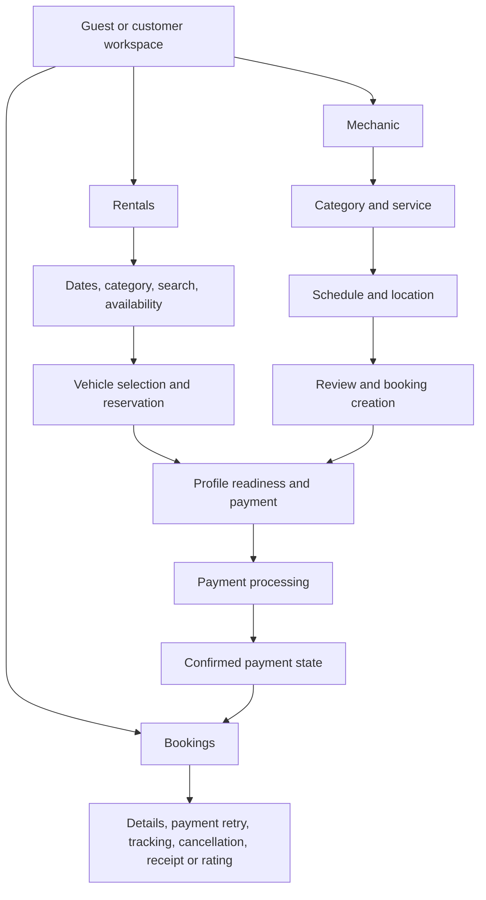
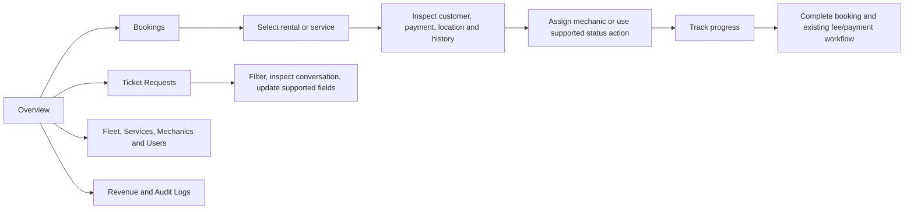

# LS Customs: customer and admin frontend design plan

Prepared 11 October 2026. Scope: analysis and proposed frontend redesign only. No application code or backend changes were made.

## Design read

An automotive service workspace for customers and an operations dashboard for staff. Preserve the LS Customs logo, recognizable green/ink palette, existing navigation labels, routes, legal content, and supported workflows. Evolve the interface toward a calm, precise automotive language: clear prices, useful imagery, strong status hierarchy, and restrained motion.

The requested design-taste-frontend skill primarily targets marketing pages. Apply its audit-first process, typography, spacing, consistency, and accessibility principles here. Do not apply its marketing-page restrictions to operational tables, progress timelines, or data density.

This is a source-based audit of React components and CSS, not a rendered browser usability test. Layout, contrast, mobile fit, and interaction findings require visual verification before implementation is considered complete.

## Current frontend and system flows

The frontend uses React 18, TypeScript, Vite, plain CSS, Capacitor for Android, Leaflet maps, Stripe payment UI, and Supabase client hooks. Lucide and Ionic icons coexist. There is no reason to replace the framework or introduce a new component framework for this proposal.

Customer navigation: Workspace, Rentals, Mechanic, Bookings, Profile. Guest browsing, authentication, account setup, support, notifications, favorites, promotions, and emergency dispatch surround these main flows.

Mechanic steps are explicitly Category → Service → Schedule → Location → Review → Payment, followed by confirmation. Service selection from the workspace can preselect a service and move into scheduling. Rentals use selected dates, live availability, reservation holds, profile completeness checks, and payment. A booking record can exist before payment succeeds. UI success must follow the existing authoritative payment status rather than the initial payment form callback.

Admin navigation: Overview, Fleet, Services, Mechanics, Users, Bookings, Ticket Requests, Revenue, Audit Logs. Customer presentation settings are also exposed through the admin navigation. Admin panels stay mounted and are hidden when inactive; preserve this behavior unless a separate frontend performance review justifies changing it.

These diagrams describe interface paths, not new backend state machines. The current permissions, validation, status transitions, reservation rules, and payment providers remain authoritative.

## Audit findings

| Finding and source | Why it matters | Proposed frontend response |
|---|---|---|
| `Dashboard.tsx`: promotion block precedes greeting; quick actions repeat hero rental/mechanic CTAs; looping video occupies the main hero | Multiple elements compete with the customer's immediate task | Lead with active booking when present, then quick actions; make promotional content subordinate |
| `Dashboard.tsx`: favorite vehicle `onBook` only calls a notification | A booking action appears functional but does not advance the journey | Connect to the existing rental selection path, or use an honest browsing label until that connection exists |
| `styles.css` and `admin.css`: DM Sans/Playfair styling, small text, many hard-coded values and overrides | Visual consistency is difficult to maintain; small labels are harder to scan | Keep DM Sans as the shared sans-serif family; consolidate tokens and retire decorative serif emphasis in dashboard UI |
| `AdminOverview.tsx`: notification badge is literal `3`; live label is unconditional | UI implies operational evidence that the component does not establish | Remove the count unless an existing notification source supplies it; describe actual loading/error states |
| `AdminOverview.tsx`: empty-map fallback uses Los Angeles coordinates | An empty map may imply a meaningful service location | Show a useful empty state; use only an existing configured location if available |
| `AdminOverview.tsx` and `AdminBookings.tsx`: dark-theme inline colors coexist with light surfaces | Theme fragments can weaken contrast and create a disconnected appearance | Replace presentation literals with scoped semantic tokens; verify rendered contrast |
| `AdminBookings.tsx`: table minimum width of 1000px, map above table, multiple detail/modal patterns | Routine triage competes with spatial detail; small screens require substantial scrolling | List-first desktop workspace with one consistent detail surface; compact stacked records on phones |
| `AdminOverview.tsx`: Lucide and Ionic icons appear together | Mixed icon treatment weakens coherence | Standardize dashboard UI on the existing Lucide family, without adding a dependency |
| `RentalPayment.tsx`, `StepPayment.tsx`, `Bookings.tsx`: pending, failed, processing, succeeded and hold states | Payment uncertainty is part of the real product flow | Treat each state as a designed screen with contextual next steps |
| CSS search found isolated focus styles and no `prefers-reduced-motion` rule in the two main stylesheets | Accessibility is not consistently expressed at the stylesheet level | Audit all interactive controls and add a shared focus and reduced-motion baseline |

Preserve useful existing pieces: live availability, favorite filtering and its empty state, booking timelines, payment retries, record audit trails, skeletons, map boundaries, error boundaries, and current dialog accessibility where present.

## Proposed visual system

Use one shared semantic token system with customer and admin density variants. Continue with native CSS and existing components; this is a brand-preserving evolution, not an imitation of Fluent or Carbon.

| Element | Proposed direction |
|---|---|
| Surfaces | Light neutral canvas, white working surfaces, ink navigation; avoid alternating decorative themes |
| Brand | Preserve existing green approximately `#3f785c` and ink `#142026`; keep gold as a restrained secondary brand detail |
| Status | Success, warning, danger and informational tokens separate from brand accent; always include readable labels |
| Type | Self-host DM Sans, regular/medium/semibold; tabular numerals for prices and metrics; remove dashboard serif embellishments |
| Scale | Body 16px customer / 14–15px admin; supporting labels generally 12–14px; page headings 28–32px |
| Spacing | Shared 4/8/12/16/24/32/48px rhythm; fewer nested cards and more meaningful grouping |
| Shape | 8px controls, 12px panels, full radius only for genuine badges or avatars |
| Actions | One dominant action per task surface; explicit labels for consequential actions; consistent disabled/loading states |
| Motion | Short 120–180ms state transitions; no scroll-reveal dependency for essential content; reduced-motion support |
| Imagery | Existing fleet/service assets where useful; predictable image crops; static workspace imagery instead of default looping video |

Skill dials: customer DESIGN_VARIANCE 4, MOTION_INTENSITY 2, VISUAL_DENSITY 4; admin 3 / 2 / 7. These prioritize task clarity and staff scanning over marketing spectacle. Final color pairs must pass contrast checks; the values above are starting brand references, not certified accessible pairings.

## Customer screen plan

### Workspace

Desktop hierarchy: greeting → active booking/next action → rental and mechanic quick actions → favorites → recommended services → optional compact promotion. Use a main content column with a smaller contextual column for location or booking summary. Show a helpful first-booking state when no active booking exists. A booking summary should display service/vehicle, current status, appointment, payment state, and the relevant existing action.

Reuse `useCustomerBookings` data only after confirming its exposed fields. Do not invent ETA, tracking freshness, availability guarantees, or personalized recommendations. Recommendations should reflect the current trending service data and be labeled accordingly.

### Rentals

Keep dates and availability context visible above results. Group category and search controls into one toolbar. Cards should prioritize vehicle name, image, core specifications, daily price, and date-specific availability. Never imply availability before valid dates are selected. Distinguish “View details” from the action that creates the existing reservation.

The detail/payment layout should prioritize dates, price breakdown, promo, rental rules, profile readiness, hold expiry and payment. Keep imagery secondary once checkout starts. Show field-linked profile requirements and an existing path to complete them. Preserve server-calculated totals and the current maximum rental duration.

### Mechanic booking

Keep all six steps and field order. Desktop: clear step title, current form, sticky summary, consistent Back/Continue placement. Mobile: “Step X of 6,” concise current step title, expandable summary, action footer that respects the keyboard and safe area. Preserve preselected services and existing validation. Explain location permission, offer the current manual location method, and show service/distance fees using the existing quote.

Review should distinguish the act of creating a booking from paying. Payment should show pending/processing/error states plainly and retain payment retry behavior. Confirmation should offer the existing booking/tracking destination without promising an unsupported arrival time.

### Bookings and Profile

Bookings: lead each record with what was booked, date, booking status, separate payment status, and one useful next action. Use the existing filters; distinguish “no bookings” from “no results.” Standardize the detail dialog, timeline, receipt, cancellation and rating patterns. Preserve notification-selected booking behavior and reservation expiry information.

Profile: group account details, addresses, preferences and security in a consistent hierarchy. Show incomplete required information inline. Preserve current fields, legal text, account rules and save handlers.

## Admin screen plan

### Shell and Overview

Preserve navigation labels and destinations. Improve spacing, selected states, count badges, keyboard focus and narrow-screen drawer behavior. Add visual grouping through separators without renaming items. Use a consistent page title, supporting description and page-action area.

Overview should answer “What needs attention?” before showing broad summaries. Lead with existing actionable booking/ticket counts and links, then live metrics, recent bookings, technician status and the map. Keep the map useful for dispatch rather than automatically making it the largest element. Show unavailable data as unavailable, never as zero. New queue categories must be derived from fields already available; otherwise omit them in this scope.

### Bookings and dispatch

Retain vehicle, service and transaction tabs. Use a stable search/filter bar above a scannable table: reference, customer, booked item, schedule, booking status, payment status, total and actions, limited to existing data. Prioritize essential columns at narrower widths. Align numeric values and make the selected record obvious.

Replace competing detail surfaces with one consistent desktop drawer and a full-screen phone detail surface. The selected booking's map, customer information, existing technician assignment, payment, timeline and audit trail belong there. Present “Assign mechanic,” “Complete,” and “Cancel” as contextual labeled actions. Preserve every existing eligibility check and handler. Keep existing fee/payment requirements visible before completing a booking. Retain any already-required confirmation dialogs.

### Remaining admin pages

| Area | Design treatment |
|---|---|
| Fleet | Image-supported inventory, clear availability/status, consistent create/edit forms |
| Services | Category, price, duration and active state with existing fields and validation |
| Mechanics | Readable roster, current status and supported scheduling/assignment context |
| Users | Searchable records, account details and existing logbook/audit context |
| Ticket Requests | Filtered request list with a clear conversation detail surface; priority and state expressed through labels |
| Revenue / transactions | Reporting period and current filters visible; readable amounts; explicit loading/empty/error states |
| Audit Logs | Dense readable rows, stable timestamps and existing record context; preserve audit content |
| Customer presentation settings | Consistent editor controls and local preview of existing settings, without changing saved field structure |

## Responsive and interaction requirements

- Verify customer layouts at 360, 390, 768, 1024 and 1440px; admin additionally at 1280px. No page-level horizontal scrolling.
- Preserve customer destinations on mobile; adapt the current navigation rather than introducing new route names.
- Use approximately 44px customer touch targets. Allow denser admin rows while keeping explicit touch actions usable.
- On mobile admin, use compact records and full-screen detail views; allow contained horizontal scrolling only when genuinely required for financial comparison tables.
- Every dialog: accessible name, focus trap, Escape behavior where appropriate, focus restoration, scroll containment, reachable close action.
- Preserve entered values through existing back navigation. Do not claim cross-session persistence unless already supported.
- Provide skeleton, first-use empty, filtered-empty, error/retry, disabled, submitting and success variants for each major component.
- Handle permission denial, unavailable map data, stale/unavailable live data, payment failure and expired reservations with the existing recovery actions.
- Verify text contrast, visible focus, keyboard navigation, screen-reader status announcements and reduced motion. Ensure sticky controls do not obscure content or the mobile keyboard.

## Frontend implementation sequence

1. **Baseline and contract inventory.** Capture customer/admin desktop and phone screenshots using authorized test access. Record available fields, existing handlers, routes, booking statuses and payment UI states. Avoid production writes during the audit.
2. **Shared foundation.** Consolidate scoped tokens, typography, spacing, buttons, inputs, badges, page headings and dialog styling. Preserve application behavior. Keep CSS migration incremental rather than adding another override layer.
3. **Customer shell and Workspace.** Establish task hierarchy and active-booking presentation; resolve the favorite booking action; reduce hero/promotion dominance.
4. **Customer booking paths.** Apply the system to Rentals, mechanic steps, payment, confirmation and Bookings. Verify holds, retries, back navigation and location fallback.
5. **Admin shell and Overview.** Remove unsupported indicators; apply consistent theme; prioritize available operational actions.
6. **Admin Bookings.** Standardize table/filter/detail patterns and adapt them for phones while preserving mutation handlers.
7. **Remaining pages and accessibility review.** Apply patterns to inventory, users, tickets, finance, audit logs, Profile and settings. Verify Android safe areas and keyboard behavior.

Relevant frontend files: `apps/web/src/styles.css`, `admin.css`, `components/layout/*`, `components/common/*`, `components/views/*`, and `components/admin/*`. Presentation-only state and composition may change. Existing hooks can be consumed, but their queries, mutation behavior and contract remain unchanged.

Explicitly excluded: `apps/backend`, database schema/migrations, Supabase functions/RPCs/RLS, authentication policy, payment processing, pricing formulas, notification delivery, dispatch rules, status transitions, and backend tests. A visual request requiring unavailable data should be omitted or separately documented, never solved by silently expanding scope.

## Acceptance and review
Review visual consistency and end-to-end frontend behavior with existing test fixtures or authorized test accounts. Cover guest/authenticated states, rental selection and hold expiry, all mechanic steps, asynchronous payment confirmation and retry, booking details and tracking, admin assignment and completion, and ticket conversation states. Never trigger real charges or customer notifications for design verification.

Run the existing web typecheck/build when implementation occurs. Use targeted interaction checks for meaningful behavioral changes; CSS-only adjustments primarily need visual and accessibility verification. Confirm that backend files and client request payloads/status rules did not change.

Success means customers can identify their next action immediately, staff can inspect and act on an existing booking without navigating competing detail patterns, both dashboards share a coherent visual system, and every existing booking/payment operation remains intact.
